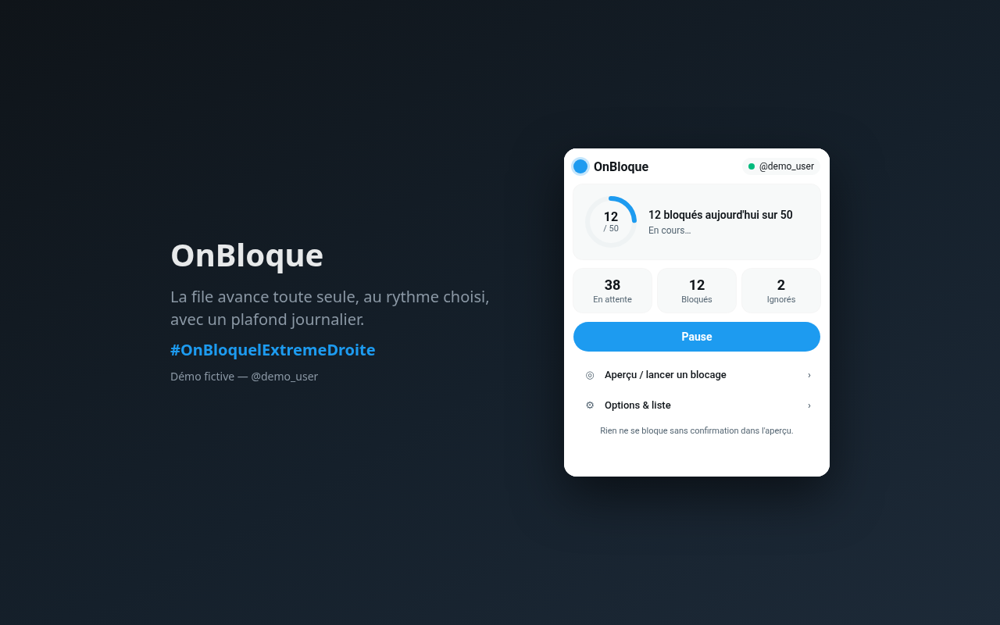
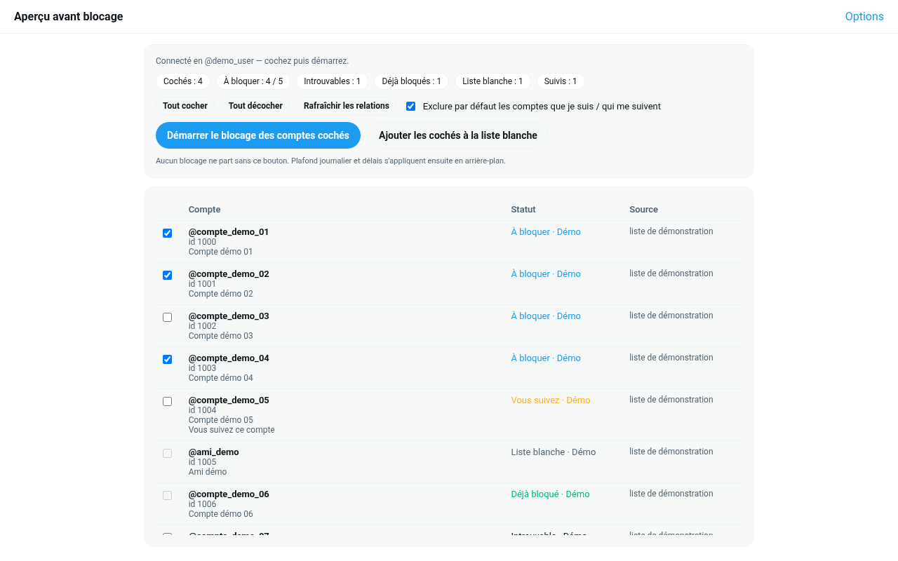
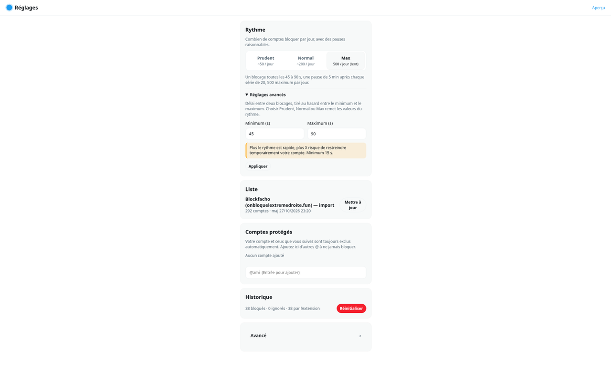
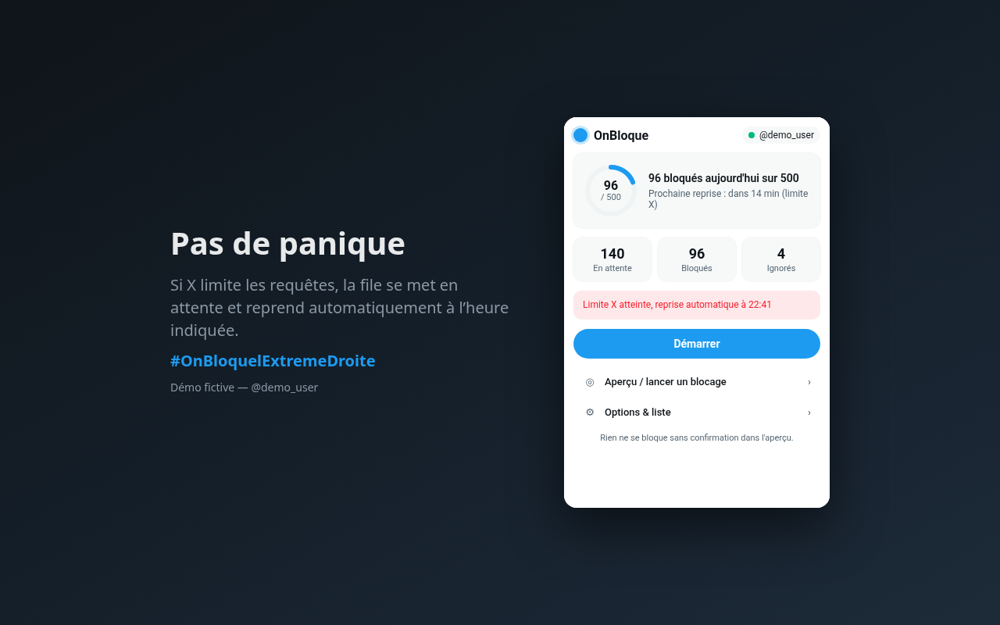
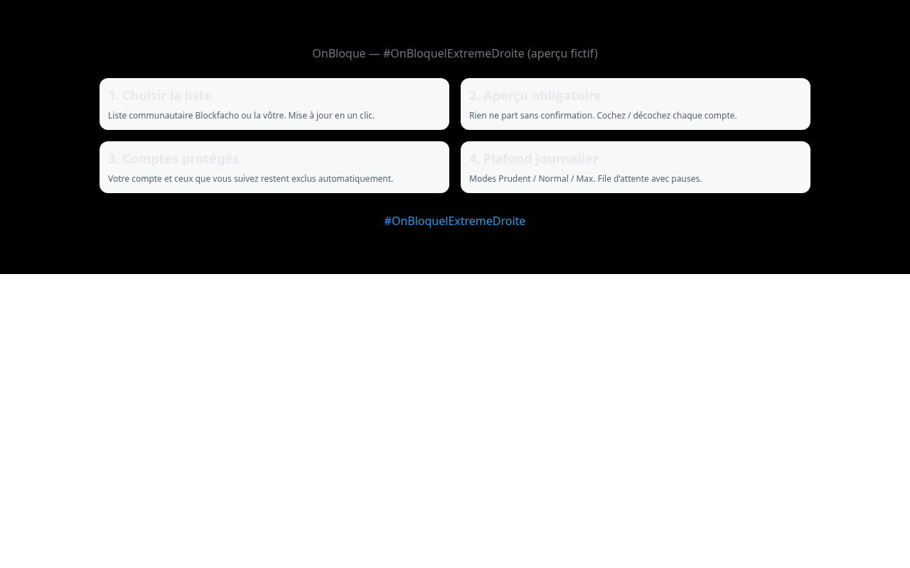

# OnBloque

Une extension Chrome pour bloquer d'un coup les comptes d'extrême droite sur X. #OnBloquelExtremeDroite

### ⬇️ [Télécharger la dernière version (zip)](https://github.com/filapaise/onbloque-extension/releases/latest)

## Installation en 1 minute

1. Télécharge le zip (lien juste au-dessus) et décompresse-le dans un dossier que tu gardes.
2. Ouvre `chrome://extensions` et active le **Mode développeur** (en haut à droite).
3. Clique sur **Charger l'extension non empaquetée** et choisis le dossier décompressé.
4. Va sur [x.com](https://x.com) et clique sur le bouton **OnBloque** (le petit rond en bas à droite).

<p></p>

Ça marche aussi sur Brave, Edge, Vivaldi et Arc.

---

## C'est quoi

J'en avais marre de bloquer les comptes un par un, alors j'ai vibe codé une extension qui le fait pour moi.

La liste de départ vient du répertoire Blockfacho ([onbloquelextremedroite.fun](https://onbloquelextremedroite.fun/site)). Tu peux aussi mettre ta propre liste.

## Ce que ça fait

- **Tu vois la liste avant.** Rien n'est bloqué sans ton accord, tu coches et décoches qui tu veux.
- **Les gens que tu suis sont protégés.** Ton compte, ceux que tu suis et ceux qui te suivent sont exclus. Tu peux aussi ajouter des comptes à épargner.
- **Ça va doucement, exprès.** Il y a une limite par jour et une attente entre deux blocages, pour que X ne prenne pas ton compte pour un robot.
  - Prudent (par défaut) : environ 50 par jour
  - Normal : environ 200 par jour
  - Max : 500 par jour, un blocage toutes les 45 à 90 s
- **Tu vois où ça en est.** Compte à rebours avant le prochain blocage, barre de progression, dernier compte bloqué, heure de fin estimée. Le badge sur l'icône montre combien il en reste.
- **Ça tourne en fond.** Tu peux mettre en pause et reprendre quand tu veux. Garde juste un onglet x.com ouvert.
- **Ça repart tout seul.** Si X ralentit, la file attend puis reprend. Un compte supprimé est juste ignoré.
- Listes en JSON, CSV ou texte (à coller, en fichier ou par URL https).

## Captures

*Faites avec des données de démo (comptes fictifs).*


*L'aperçu : tu choisis qui bloquer. Les comptes que tu suis, ceux déjà bloqués et ceux qui n'existent plus sont décochés.*


*Les réglages : rythme, liste, comptes protégés, historique.*


*Si X limite les requêtes, la file attend et repart toute seule.*



## Mettre à jour

Télécharge le nouveau zip, remplace le contenu du dossier, puis clique sur ↻ (Recharger) sur la carte OnBloque dans `chrome://extensions`.

## Tes données

- Rien n'est envoyé ailleurs. Pas de serveur, pas de compte, pas de pistage.
- Tout reste dans ton navigateur : la liste, les réglages, la file.
- L'extension parle seulement à x.com (avec ta session déjà ouverte) et à l'URL de liste que tu choisis.
- Le jeton de session est lu au moment du blocage, jamais enregistré.

Le détail : [PRIVACY.md](PRIVACY.md).

## À savoir

L'extension utilise les mêmes requêtes que le site x.com dans ton navigateur, pas l'API officielle. Si tu bloques trop vite, X peut restreindre ton compte un moment. Si tu débutes, reste en Prudent. À tes risques.

## Compiler depuis les sources

Il te faut Node.js 20 ou plus.

```bash
git clone https://github.com/filapaise/onbloque-extension.git
cd onbloque-extension
npm install
npm test
npm run build      # → dist/, à charger comme extension non empaquetée
npm run zip        # → release/onbloque-<version>.zip
```

| Dossier | Rôle |
|--------|------|
| `src/domain/` | Types, lecture des listes, file, aperçu |
| `src/infra/` | Stockage Chrome, requêtes x.com |
| `src/application/` | Services liste, aperçu, file |
| `src/background/` | Service worker et validation des messages |
| `src/content/` | Bouton sur x.com |
| `src/ui/` | Popup, réglages, aperçu |
| `lists/seed.json` | Liste de départ |
| `tests/` | Tests (`node --test`) |

Format de liste `onbloque-list/1` :

```json
{
  "format": "onbloque-list/1",
  "name": "Ma liste",
  "entries": [
    { "handle": "Exemple", "id": "123" }
  ]
}
```

## Contact

[@fil_apaise](https://x.com/fil_apaise) · `fil.apaise@gmail.com`

---

## English

A Chrome extension to block far-right accounts on X from a shared list. #OnBloquelExtremeDroite

**Install:** download the zip from [the latest release](https://github.com/filapaise/onbloque-extension/releases/latest) and unzip it. Open `chrome://extensions`, turn on **Developer mode**, click **Load unpacked** and pick the unzipped folder. Then go to x.com and click the OnBloque button.

- You see the list first and pick who gets blocked.
- People you follow, and people who follow you, are skipped.
- Daily cap and slow pace on purpose, so X doesn't flag your account.
- Nothing leaves your browser. See [PRIVACY.md](PRIVACY.md).

**Build:** `npm install && npm test && npm run build`, then load `dist/`.

## Licence

[MIT](LICENSE) © 2026 Fil Apaisé
